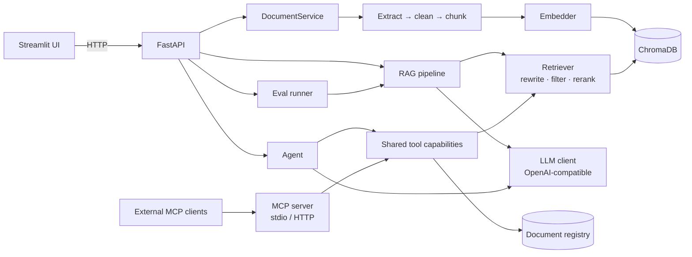

# NEXUS AI — Intelligent Knowledge & Agent Assistant

Upload documents, ask questions, get answers with citations, or let a tool-using agent work over your knowledge base. The same tools are exposed through a real MCP server, and a deterministic evaluation harness measures retrieval and answer quality.

## Features

- **Document ingestion** — PDF, DOCX, TXT, Markdown; page-aware extraction, configurable chunking, duplicate detection (SHA-256), size limits, filename sanitising.
- **RAG** — ChromaDB cosine retrieval, metadata (document) filtering, top-k, score threshold, optional query rewriting and reranking, context size limits, citations restricted to sources actually shown to the model, explicit "insufficient context" behaviour.
- **Agent** — single tool-calling loop with an iteration cap, per-call tool cap, validated arguments, allow-listed read-only tools, and a step-by-step trace. Tools: `search_knowledge_base`, `get_document_metadata`, `list_available_documents`, `calculator`.
- **MCP server** — official Python SDK; tools `search_documents`, `get_document_info`, `list_documents`, `calculate` with JSON schemas, read-only annotations and structured results. stdio (default) or streamable HTTP.
- **Evaluation** — JSONL datasets; hit rate, MRR, recall, context precision/keyword coverage, abstention accuracy, citation precision/recall, answer keyword recall and token-F1; optional LLM-as-judge; failure report; runs against an isolated index.
- **UI** — Streamlit: dashboard, upload & library, chat (Chat / RAG / Agent), source and retrieved-context inspection, agent trace, MCP status and client config, evaluation dashboard, settings.
- **API** — FastAPI with typed schemas, optional `X-API-Key` auth, consistent error format.

## Architecture



The agent and the MCP server call one implementation of each tool (`app/tools/capabilities.py`), so both surfaces behave identically. The API and MCP server are separate processes sharing the same `DATA_DIR`; the document registry reloads when another process changes it.

## Tech stack

Python 3.11+, FastAPI, Streamlit, Pydantic v2, ChromaDB, sentence-transformers (optional extra), PyMuPDF, python-docx, official `mcp` SDK (2.x), OpenAI Python SDK (any OpenAI-compatible endpoint), pytest, Ruff, Docker.

## Installation

```bash
make install          # venv + core, UI and dev dependencies
make install-ml       # optional: sentence-transformers (downloads PyTorch)
cp .env.example .env  # then edit
```

Without `make`: `python3 -m venv .venv && .venv/bin/pip install -e ".[ui,dev]"`.

## Configuration

Everything is configured through environment variables / `.env` (see `.env.example`). Never commit `.env`.

| Variable | Purpose |
|---|---|
| `LLM_BASE_URL`, `LLM_API_KEY`, `LLM_MODEL` | Any OpenAI-compatible provider (OpenAI, Groq, OpenRouter, Ollama, vLLM…). Switching provider = changing these. |
| `SYSTEM_PROMPT` | Optional override of the default system prompt. |
| `EMBEDDING_BACKEND` | `sentence-transformers` (semantic, default) or `hashing` (offline, lexical). |
| `CHUNK_SIZE`, `CHUNK_OVERLAP`, `TOP_K`, `MIN_SCORE`, `MAX_CONTEXT_CHARS` | Ingestion / retrieval tuning. |
| `ENABLE_QUERY_REWRITE`, `ENABLE_RERANK` | Optional, off by default (extra LLM call / extra compute). |
| `NEXUS_API_KEY` | If set, the API requires `X-API-Key` on every route except `/health`. |

**Using the `hashing` backend?** Its cosine scores are low because it is lexical. Set `MIN_SCORE=0.05`, or relevant passages are filtered out.

## Running

```bash
make api      # backend  → http://127.0.0.1:8000  (docs at /docs)
make ui       # frontend → http://localhost:8501  (needs the API running)
make mcp      # MCP server over stdio
python -m app.mcp.server --transport streamable-http --port 8001   # MCP over HTTP
```

### MCP client configuration

The UI's **MCP Server** page generates this for your machine. Shape (stdio):

```json
{
  "mcpServers": {
    "nexus-ai": {
      "command": "/path/to/nexus-ai/.venv/bin/python",
      "args": ["-m", "app.mcp.server"],
      "cwd": "/path/to/nexus-ai",
      "env": { "DATA_DIR": "/path/to/nexus-ai/data", "EMBEDDING_BACKEND": "sentence-transformers" }
    }
  }
}
```

stdout carries the protocol; all server logging goes to stderr.

### Docker

```bash
docker compose up --build     # API :8000, UI :8501; secrets from your local .env
INSTALL_ML=false docker compose up --build   # slim image; set EMBEDDING_BACKEND=hashing
```

## Tests and lint

```bash
make test     # pytest (no network, API key or model download required)
make lint
```

## Evaluations

```bash
make eval        # retrieval-only: hit rate, MRR, recall, context metrics, abstention
make eval-llm    # + answer correctness and citation metrics (needs LLM_API_KEY)
python -m app.evaluation.runner --llm --judge --top-k 3   # + optional LLM-as-judge
```

Datasets are JSONL in `evals/datasets/` (one case per line):

```json
{"id": "q1", "question": "...", "expected_answer": "...", "expected_sources": ["file.md"], "expected_keywords": ["..."], "answerable": true}
```

Add your own corpus files to `evals/datasets/corpus/` and cases to a new `.jsonl`. Reports are written to `evals/results/` and shown in the UI. Answer correctness is deterministic (all `expected_keywords` present in the answer); the judge is opt-in.

## Example usage

```bash
curl -F "file=@evals/datasets/corpus/product_faq.md" localhost:8000/documents
curl -X POST localhost:8000/rag/retrieve -H 'content-type: application/json' \
     -d '{"question": "API rate limit on the Pro plan?"}'          # no LLM needed
curl -X POST localhost:8000/rag/query   -H 'content-type: application/json' \
     -d '{"question": "API rate limit on the Pro plan?"}'          # needs LLM_API_KEY
curl -X POST localhost:8000/agent/query -H 'content-type: application/json' \
     -d '{"question": "What is 29 * 12, and which document mentions the Pro plan?"}'
```

## Project structure

```
app/
  api/          FastAPI app, routers, auth dependency
  frontend/     Streamlit entrypoint, views, API client (no business logic)
  core/         config, logging (JSON + redaction), errors
  llm/          LLMClient interface + OpenAI-compatible implementation
  ingestion/    upload validation, extraction, chunking
  embeddings/   sentence-transformers and offline hashing embedders
  vectorstore/  ChromaDB wrapper
  retrieval/    query rewrite, retriever, rerankers
  rag/          context building, citations, pipeline
  agents/       tool-calling agent loop
  tools/        safe calculator, shared capabilities, agent tool registry
  mcp/          MCP server, health probe, client config
  evaluation/   dataset, metrics, judge, runner
  services/     container, document service, registry
  schemas/      Pydantic request/response models
tests/{unit,integration}   evals/{datasets,results}   data/{uploads,chroma}
```

## Security notes

Uploaded and retrieved text is treated as untrusted: delimiter sequences are neutralised, prompts instruct the model to ignore instructions in sources, and the agent can only call allow-listed, read-only tools with schema-validated arguments (a test covers a document attempting to trigger a non-existent destructive tool). The calculator uses an `ast` allow-list, never `eval`. Uploads are limited by extension, magic bytes and size. Secrets are masked in `/config` and redacted from logs.

## Limitations

- Scanned/image-only PDFs are not supported (no OCR).
- Semantic embeddings need a one-time model download from Hugging Face; the offline `hashing` fallback is lexical and noticeably weaker.
- Ingestion is synchronous and single-process; one local Chroma store, no multi-user separation.
- The bundled evaluation set is a small smoke test (3 documents, 10 questions). It shows the harness works; it is not evidence of production accuracy.
- Answer correctness uses keyword matching, which can mis-score paraphrases; use `--judge` for a second opinion.
- Streaming is implemented for plain chat only; RAG and agent responses return when complete.
- The MCP server has no authentication on the HTTP transport; bind to localhost only.

## Future improvements

Hybrid (BM25 + vector) retrieval, OCR, background ingestion queue, per-user collections, streaming RAG answers, larger and domain-specific eval sets with confidence intervals, authentication for HTTP MCP.
